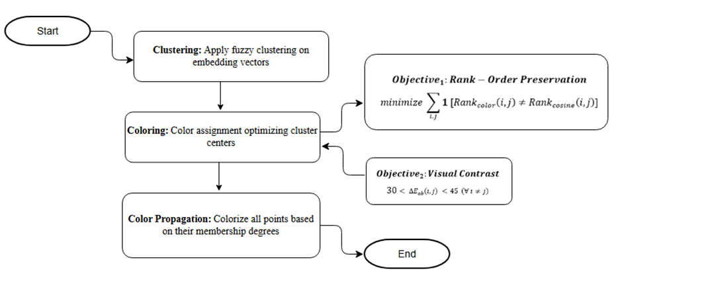
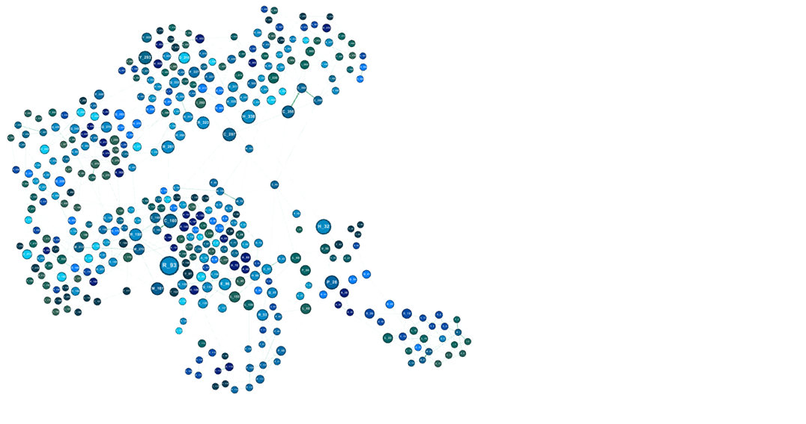
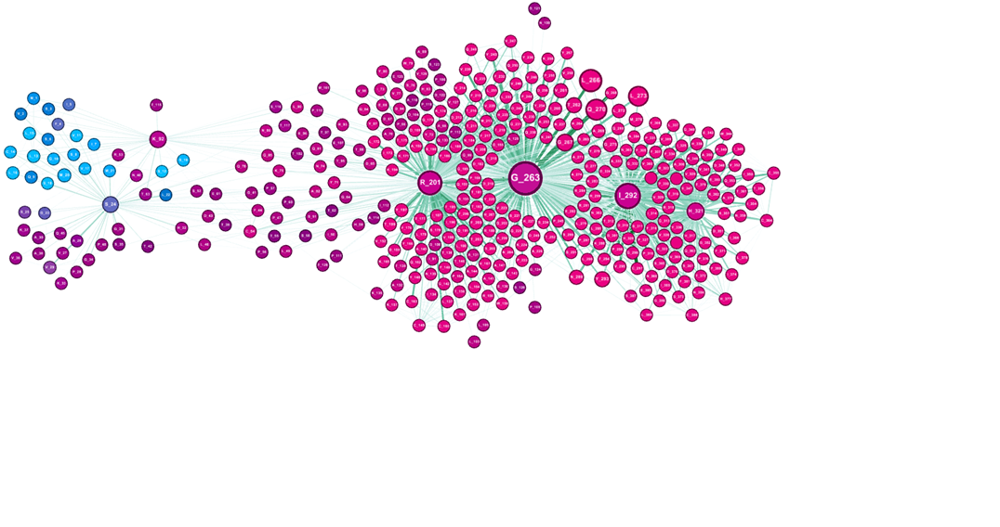
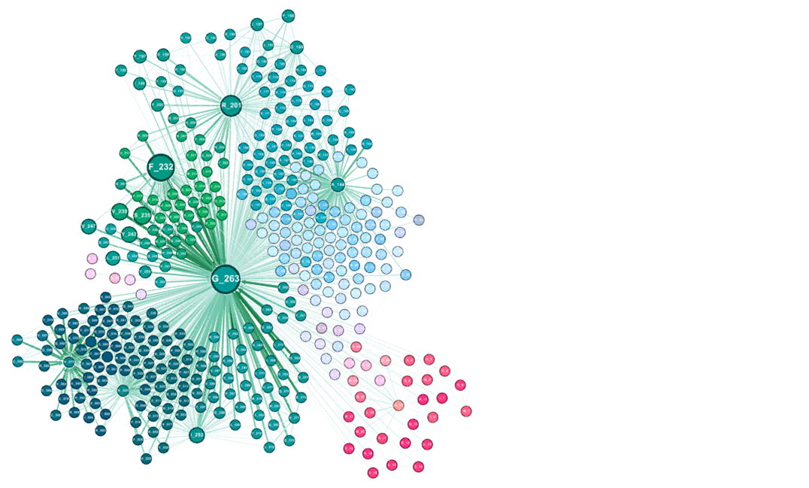
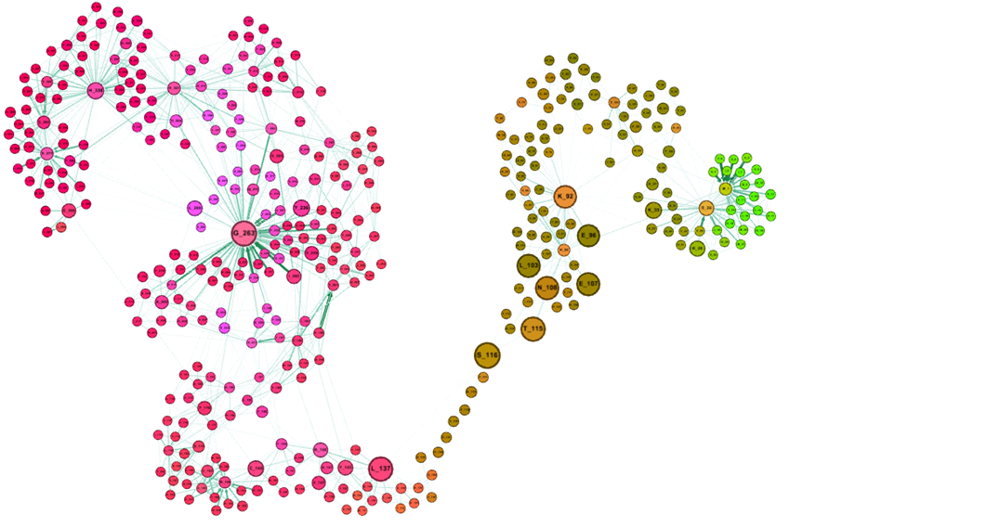
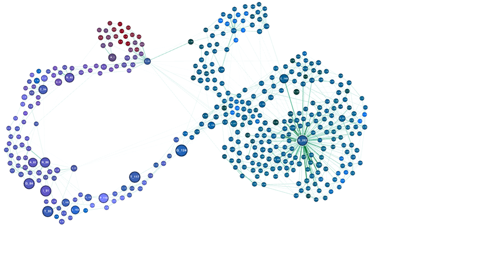

# Layer-wise Topological Interpretation of Protein Language Models through Semantic Visualization

This repository contains the core implementation scripts, pipelines, and visual examples associated with our study on layer-wise protein language model (pLM) representations and semantic visualization in the twilight zone.

---

## 🔬 Overview & Contributions

The study has two complementary components:

1. **Layer-wise Diagnostic & Interpretability Advisor:** 
   We systematically probe intermediate transformer layers across modern protein language models (ESM-2, ProtT5, and ProtBERT). This framework is designed as an interpretive and diagnostic aid to examine how representations balance sequence fidelity versus 3D topological preservation; it is not a general-purpose prediction method or alignment benchmark.

2. **Semantic Coloring & Visualization Framework:** 
   We propose a structure-informed visualization paradigm that translates high-dimensional per-residue embeddings into perceptual CIELAB colors using Fuzzy C-Means and NSGA-III multi-objective optimization. This enables intuitive, residue-level visual inspection of functional/structural conservation beyond classical monochrome alignments.

---

## 🎨 Semantic Coloring Pipeline

The end-to-end framework mapping layer embeddings into optimized perceptual color palettes:

  

**Figure 1.** The semantic coloring pipeline consists of three main stages: (1) **Clustering:** Application of fuzzy clustering on embedding vectors to identify latent structures; (2) **Coloring:** Optimization of cluster centers in the CIELAB color space, constrained by rank-order preservation and visual contrast requirements; and (3) **Color Propagation:** Final assignment of color values to all data points based on their respective membership degrees to the optimized clusters.

---

## 📊 Layer-wise Network Visualizations

The following network visualizations show the semantic relationships and structural alignments obtained at five selected model layers (**Layers 3, 12, 16, 20, and 24**). They illustrate how the network representation evolves across the model depth.

### Layer 3

  

### Layer 12

  

### Layer 16

  

### Layer 20

  

### Layer 24

  

---

## 📂 Repository Structure

1. **`get_data_from_RCSB.py`**  
   - Retrieves protein sequence pairs from the RCSB PDB database using `SequenceQuery` and submits structural alignment jobs via the `smith-waterman-3d` API to filter twilight-zone pairs.

2. **`filter_after_get_data_from_RCSB.py`**  
   - Post-processes and cleans the retrieved dataset by removing duplicate and symmetric pairs (yielding the filtered dataset of $N=1,133$ pairs: 900 training and 233 test pairs).

3. **`extract_embedding.py`**  
   - Extracts per-residue hidden state embeddings from the encoder-only **ProtT5** model (`Rostlab/prot_t5_xl_half_uniref50-enc`).

4. **`extract_semantic_color.py`**  
   - Implements the core semantic coloring pipeline:
     - Maps per-residue embeddings into clusters using **Fuzzy C-Means**.
     - Optimizes color palettes in the **CIELAB** color space using **NSGA-III**.
     - Performs Smith-Waterman alignment on semantic colors with CIEDE2000 scoring.
     - Optimizes color thresholds via **Bayesian Optimization** on the training set.

---

## 📋 Citation

If you use this code or findings in your research, please cite our paper:

> [Add full citation details here once available]
